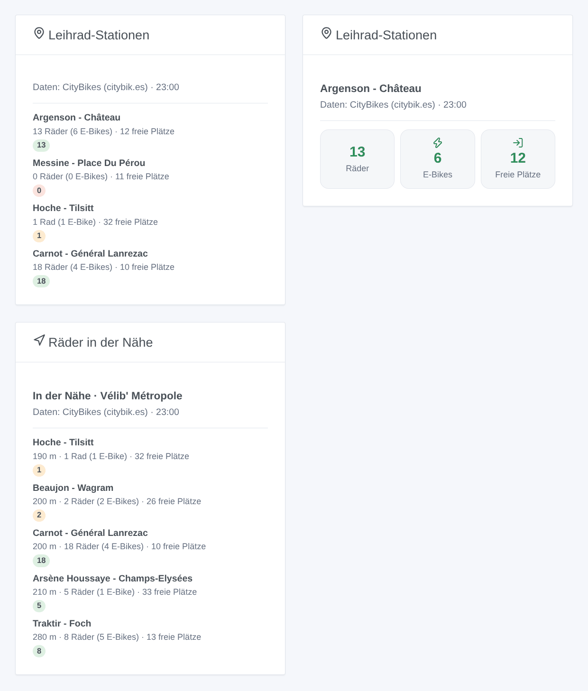
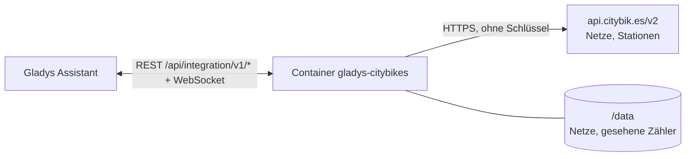
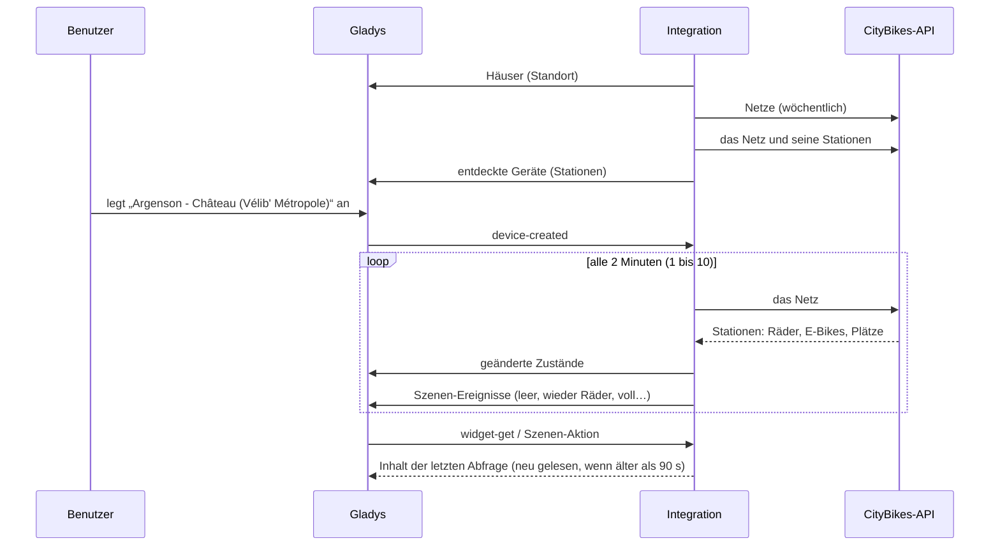

# Gladys CityBikes

[English](README.md) · [Français](README.fr.md) · **Deutsch** · [Español](README.es.md)

[](LICENSE)
[](https://github.com/William-De71/gladys-citybikes/releases)
[](https://github.com/William-De71/gladys-citybikes/actions/workflows/release.yml)
[](https://gladysassistant.com)


Externe Integration für [Gladys Assistant](https://gladysassistant.com) für die **Leihrad-Stationen** von mehr als 800 Netzen weltweit (Vélib', nextbike, Bicing, WienMobil Rad, Santander Cycles…): verfügbare Räder, E-Bikes und freie Plätze an deinen Stationen, mit Szenen und Dashboard-Widgets. Sie liest die kostenlose [CityBikes](https://citybik.es)-API, ohne Konto und ohne Schlüssel.

Benutzerdokumentation: [English](docs/en.md) · [Français](docs/fr.md) · [Deutsch](docs/de.md) · [Español](docs/es.md).

> Community-Integration, nicht mit dem CityBikes-Projekt oder einem Leihradbetreiber verbunden und nicht von ihnen unterstützt. Daten: CityBikes (citybik.es).

## Funktionen

- **Das Netz** per CityBikes-Kennung, Name oder Stadt eingetragen, oder das **dem Haus nächste** (Standortberechtigung).
- **Ein Gerät pro verfolgter Station**: bis zu 20 per Kennung oder Name eingetragene, dazu die 1 bis 5 dem Haus nächsten. Verfügbare Räder, E-Bikes, normale Räder und freie Plätze, jeweils wenn der Betreiber sie liefert.
- **6 Szenen-Auslöser**: wieder Räder verfügbar, Station leer, wieder E-Bikes verfügbar, kein E-Bike mehr, wieder freie Plätze, Station voll.
- **2 Szenen-Aktionen**: Station lesen; die nächste Station mit einem Rad, einem E-Bike oder einem freien Platz finden, vom Haus oder von einer verfolgten Station aus.
- **2 Dashboard-Widgets**: die verfolgten Stationen und die Stationen in der Nähe.
- **Konfigurations-Schaltflächen**: Verbindung testen, Netz suchen, Station suchen, Diagnose.
- Eine Anfrage pro Abfrage des Netzes (alle 1 bis 10 Minuten), innerhalb der 300 Anfragen pro Stunde der API; vier Sprachen (Englisch, Französisch, Deutsch, Spanisch).



## Funktionsweise




Beim Start liest die Integration die Liste der CityBikes-Netze (in `/data` gespeichert, wöchentlich neu gelesen) und die Häuser von Gladys und wählt dann das Netz: das eingetragene, sonst das dem Haus nächste. Jede Abfrage holt das ganze Netz mit einer Anfrage (`/v2/networks/<id>`, 1 516 Stationen bei Vélib'), findet die eingetragenen Stationen per Kennung oder Name und die dem Haus nächsten, veröffentlicht die geänderten Zustände und vergleicht die Zähler mit der vorherigen Abfrage, um die Szenen-Auslöser zu feuern.



### Transport

Nur Cloud (`"transports": ["cloud"]`): Der Katalog zeigt das Cloud-Badge, und es gibt keine Schaltfläche „Lokale Verbindung bevorzugen“. Die Integration kontaktiert `api.citybik.es`. Die Koordinaten des Hauses (`"location": true`) werden nur im Container zur Berechnung der Entfernungen verwendet: Sie werden nie an CityBikes gesendet und nie protokolliert.

## Geräte und Funktionen

| Funktion                 | Kategorie / Typ            | Bereich | Wann                                                 |
| ------------------------ | -------------------------- | ------- | ---------------------------------------------------- |
| Verfügbare Räder         | `counter-sensor` / integer | 0 – 999 | immer                                                |
| Verfügbare E-Bikes       | `counter-sensor` / integer | 0 – 999 | der Betreiber zählt die E-Bikes (Vélib', Bicing)     |
| Verfügbare normale Räder | `counter-sensor` / integer | 0 – 999 | der Betreiber zählt sie                              |
| Freie Stellplätze        | `counter-sensor` / integer | 0 – 999 | der Betreiber liefert sie (nicht stationslose Netze) |

Externe Kennung: `station:<Netz>_<Betreiber-Kennung>` (`station:velib_22002`). `should_poll` ist false: Die Integration liest nach ihrem eigenen Takt.

## Szenen-Auslöser, Aktionen und Widgets

| Art      | Schlüssel          | Verwendung                                                                  |
| -------- | ------------------ | --------------------------------------------------------------------------- |
| Auslöser | `bikes_available`  | Kein Rad an einer Station, dann mindestens eines.                           |
| Auslöser | `station_empty`    | Das letzte Rad genommen (oder die Station geschlossen).                     |
| Auslöser | `ebikes_available` | Kein E-Bike, dann mindestens eines.                                         |
| Auslöser | `ebikes_gone`      | Das letzte E-Bike genommen.                                                 |
| Auslöser | `docks_available`  | Eine volle Station, dann ein freier Platz.                                  |
| Auslöser | `station_full`     | Kein freier Platz mehr: Kein Rad kann zurückgegeben werden.                 |
| Aktion   | `get_station`      | Zähler einer Station und ein Satz.                                          |
| Aktion   | `find_station`     | Nächste Station mit einem Rad, einem E-Bike oder einem Platz, und ein Satz. |
| Widget   | `stations`         | Die verfolgten Stationen: Kacheln für eine, eine Liste für mehrere.         |
| Widget   | `nearby`           | Die 1 bis 8 dem Haus nächsten Stationen.                                    |

Die Auslöser lassen sich auf ein Stations-Gerät filtern; ihre Variablen liefern die Station, das Netz und die Zähler (-1, wenn unbekannt). Die erste Abfrage einer Station dient als Referenz, und die gesehenen Zähler werden in `/data` gespeichert: Ein Neustart feuert dasselbe Ereignis nie zweimal.

Beispiele:

- „Station leer“ an der Station vor deinem Fenster, werktags morgens → „Kein Rad mehr unten“ an dein Handy senden.
- „Wieder E-Bikes verfügbar“ → es über den Lautsprecher im Flur ansagen.
- Um 18:00 → „nächste Station finden“ mit freiem Platz von der Station des Büros aus → ihre Zusammenfassung senden.

## Voraussetzungen

- Gladys Assistant **5.3.0** oder neuer (Widgets und Szenen-Auslöser externer Integrationen, Katalog-Schlüsselwörter von Gladys 5.3). Ältere Instanzen können die Integration nicht installieren.
- Für die Stationen beim Haus: ein Standort für das Haus in Gladys und die bei der Installation akzeptierte Standortberechtigung.

## Installation

- **Aus dem Store** von Gladys (Integrationen → Externe Integrationen), mit einem Klick, sobald indiziert.
- **Über die URL des Repositorys**: `https://github.com/William-De71/gladys-citybikes`.
- **Entwicklermodus**: Baue das Image lokal (`docker build -t gladys-citybikes .`) und installiere es aus Gladys.

## Konfiguration

| Feld                  | Beschreibung                                                                          |
| --------------------- | ------------------------------------------------------------------------------------- |
| Netz                  | CityBikes-Kennung („velib“), Name oder Stadt. Leer: das dem Haus nächste Netz.        |
| Haus                  | Das Haus, von dem aus die Entfernungen gemessen werden. Leer: das erste mit Standort. |
| Verfolgte Stationen   | Bis zu 20 Kennungen oder genaue Namen, durch Kommas getrennt.                         |
| Stationen beim Haus   | Keine, 1, 2, 3 (Standard) oder 5.                                                     |
| Abfrage der Stationen | 1, 2 (Standard), 5 oder 10 Minuten.                                                   |
| Sprache der Texte     | Namen der Funktionen, Szenen-Zusammenfassungen und -Ausgaben.                         |

Schaltflächen: **Verbindung testen**, **Netz suchen** (Kennungen der Netze einer Stadt oder die dem Haus nächsten), **Station suchen** (Kennungen und aktuelle Räder) und **Diagnose** (schreibt Netz, Stationen, letzte Abfrage, Fehler und restliches Kontingent in den Tab Protokolle).

## Verwendung

1. Lass das Netz leer (das dem Haus nächste) oder finde seine Kennung mit **Netz suchen**; füge auf Wunsch Stationen hinzu und speichere.
2. Lege im Tab **Entdecken** die Stations-Geräte an.
3. Füge die Widgets **Leihrad-Stationen** und **Räder in der Nähe** einem Dashboard hinzu und baue Szenen mit den Auslösern oben.

## Entwicklung

```bash
npm install
npm test                       # node --test, nie mit Netzwerkzugriff
npm run lint && npm run format:check
npx github:GladysAssistant/integration-store . --skip-image-check
scripts/build-cover.sh         # cover.jpg aus docs/assets/cover.svg
docs/illustrations/render.sh   # docs/assets/widgets.<Sprache>.png
node .github/scripts/release.mjs next
```

Lokal liest das SDK `GLADYS_HOST_API_URL`, `GLADYS_INTEGRATION_TOKEN` und `GLADYS_INTEGRATION_SELECTOR`; `CITYBIKES_API_URL` leitet die Integration auf eine andere API-Wurzel um (eine Attrappe); `DEBUG=gladys-integration-sdk` zeigt die Protokolle des SDK und prüft jeden Widget-Inhalt. Die Tests nutzen echte, gekürzte Antworten der CityBikes-API (`test/fixtures/`). Die Regeln des Projekts stehen in [CLAUDE.md](CLAUDE.md).

## Release-Prozess


Jeder Merge auf `main` startet die CI und berechnet dann die Version aus den [Conventional Commits](https://www.conventionalcommits.org/) seit dem letzten Tag: `feat` → Minor, `fix` / `perf` → Patch, `!` oder `BREAKING CHANGE` → Major (ein Minor unter 1.0.0); `docs`, `chore`, `ci`, `test`, `style`, `refactor`, `build` allein veröffentlichen nichts. Der Changelog-Abschnitt wird erzeugt, der Tag gepusht, das Multi-Architektur-Image gebaut, dann erhält `main` den Release-Commit, das GitHub Release wird erstellt, und ein letzter Job prüft das öffentliche Image, den Store-Validator und das Topic.

- Der Titel des Pull Requests wird zum Squash-Commit und dann zur Changelog-Zeile: Schreibe ihn auf Englisch, für den Benutzer (`pr-title.yml` prüft ihn). Bearbeite `CHANGELOG.md` nie von Hand.
- 1.0.0 ist eine Entscheidung: Actions → Release → Run workflow mit `release-as: 1.0.0`. `dry-run` zeigt Version und Notizen, ohne zu veröffentlichen.
- **Geschützter Branch**: Das Release pusht seinen Commit mit `GITHUB_TOKEN` auf `main`. Mit einem Ruleset auf `main`, das strenger ist als „kein Löschen, kein Force-Push“, füge GitHub Actions zur Bypass-Liste hinzu (oder pushe über eine GitHub App), sonst schlägt der Veröffentlichungs-Job mit Anweisungen fehl.
- Mache nach dem ersten Release das Paket auf `ghcr.io` öffentlich (Package settings → Change visibility), sonst kann Gladys es nicht herunterladen.

## Fehlerbehebung

Siehe [docs/de.md](docs/de.md#fehlerbehebung). Melde Probleme mit den Versionen von Gladys und der Integration, dem betroffenen Netz und der Station sowie den Zeilen der Schaltfläche **Diagnose**.

## Mitwirken

Issues und Pull Requests sind willkommen. Führe vor einem Pull Request `npm run format:check && npm run lint && npm test` aus und lass alle externen Kennungen und gespeicherten Schlüssel unverändert (siehe [CLAUDE.md](CLAUDE.md)).

## Sicherheit

Siehe [SECURITY.md](SECURITY.md): Melde Schwachstellen vertraulich. Die Integration braucht kein Geheimnis: Sie liest nur öffentliche Daten und läuft schreibgeschützt, als Benutzer ohne Root-Rechte, in ihrem Container.

## Kommende Screenshots

Die Bilder oben sind Illustrationen, keine Screenshots. Echte Screenshots kommen nach `docs/assets/screenshots/` (PNG, 1280 × 800): `configuration.png`, `discovery.png`, `device.png`, `scene.png`.

## Lizenz

[Apache License 2.0](LICENSE) — siehe auch [NOTICE](NOTICE). Die Daten stammen vom Projekt [CityBikes](https://citybik.es) (API auf Basis von [PyBikes](https://github.com/eskerda/pybikes)), dessen Bedingungen von jedem nutzenden Projekt verlangen, es zu nennen und darauf zu verlinken: Die Widgets, die Dokumentation und dieses README tun das. Danke an die Dokumentation und das SDK von Gladys und an das CityBikes-Projekt.
