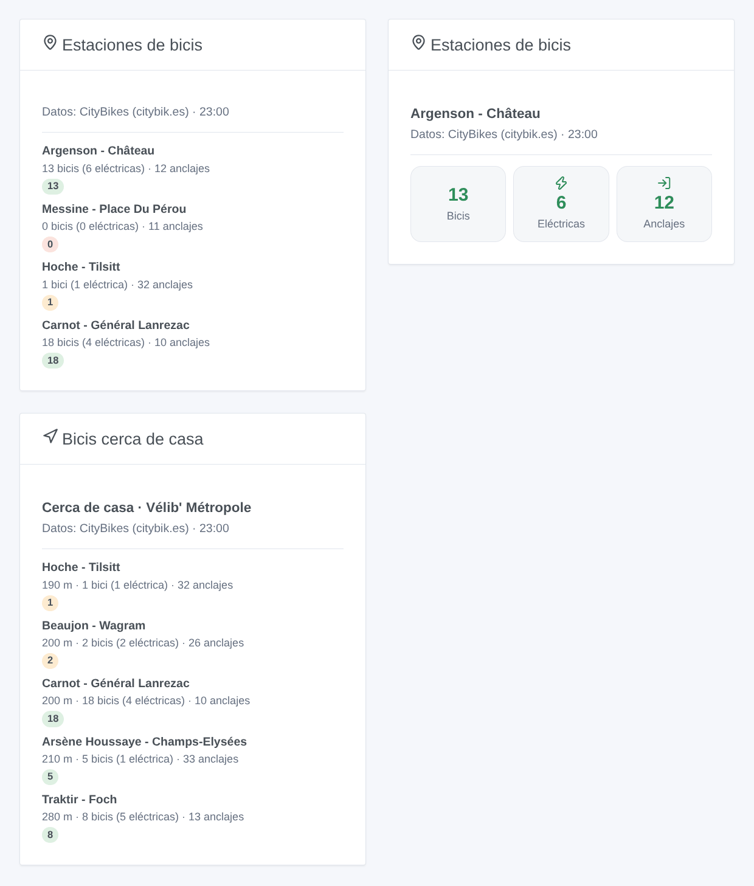
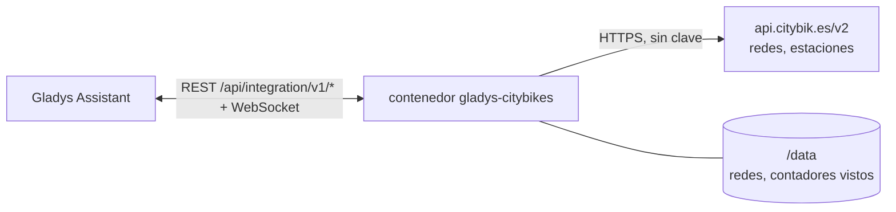
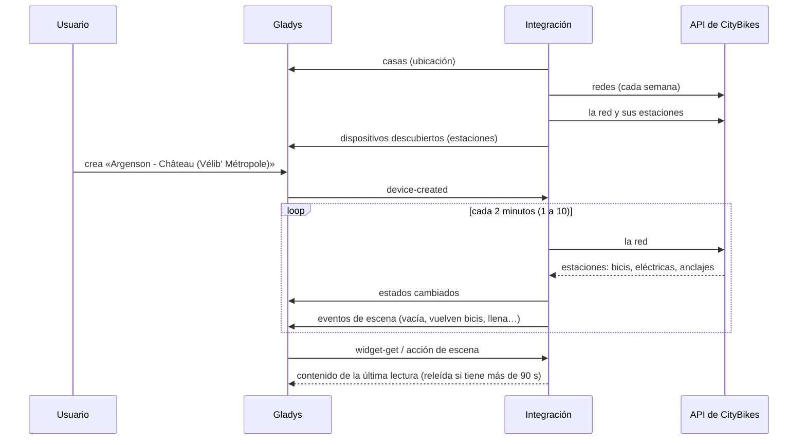

# Gladys CityBikes

[English](README.md) · [Français](README.fr.md) · [Deutsch](README.de.md) · **Español**

[](LICENSE)
[](https://github.com/William-De71/gladys-citybikes/releases)
[](https://github.com/William-De71/gladys-citybikes/actions/workflows/release.yml)
[](https://gladysassistant.com)


Integración externa de [Gladys Assistant](https://gladysassistant.com) para las **estaciones de bicicletas compartidas** de más de 800 redes en el mundo (Bicing, BiciMAD, Valenbisi, Vélib', nextbike, Santander Cycles…): bicis disponibles, eléctricas y anclajes libres de tus estaciones, con escenas y widgets del panel. Lee la API gratuita de [CityBikes](https://citybik.es), sin cuenta ni clave.

Documentación de usuario: [English](docs/en.md) · [Français](docs/fr.md) · [Deutsch](docs/de.md) · [Español](docs/es.md).

> Integración comunitaria, sin relación con el proyecto CityBikes ni con ningún operador de bicicletas compartidas, y no respaldada por ellos. Datos: CityBikes (citybik.es).

## Funcionalidades

- **La red** escrita por identificador CityBikes, nombre o ciudad, o la **más cercana a la casa** (permiso de ubicación).
- **Un dispositivo por estación seguida**: hasta 20 escritas por identificador o nombre, más las 1 a 5 más cercanas a la casa. Bicis disponibles, eléctricas, mecánicas y anclajes libres, cada uno cuando el operador lo da.
- **6 disparadores de escena**: vuelve a haber bicis, estación vacía, vuelve a haber eléctricas, no quedan eléctricas, vuelve a haber anclajes, estación llena.
- **2 acciones de escena**: leer una estación; encontrar la estación más cercana con una bici, una eléctrica o un anclaje libre, desde la casa o desde una estación seguida.
- **2 widgets del panel**: las estaciones seguidas y las estaciones cerca de casa.
- **Botones de configuración**: probar la conexión, buscar una red, buscar una estación, diagnóstico.
- Una petición por lectura de la red (cada 1 a 10 minutos), dentro de las 300 peticiones por hora de la API; cuatro idiomas (inglés, francés, alemán, español).



## Cómo funciona




Al arrancar, la integración lee la lista de redes de CityBikes (guardada en `/data`, releída cada semana) y las casas de Gladys, y elige la red: la escrita, si no la más cercana a la casa. Cada lectura pide toda la red en una petición (`/v2/networks/<id>`, 1 516 estaciones en Vélib'), encuentra las estaciones escritas por identificador o nombre y las más cercanas a la casa, publica los estados que cambiaron y compara los contadores con la lectura anterior para lanzar los disparadores de escena.



### Transporte

Solo cloud (`"transports": ["cloud"]`): el catálogo muestra la insignia cloud y no hay botón «Preferir la conexión local». La integración contacta con `api.citybik.es`. Las coordenadas de la casa (`"location": true`) solo se usan dentro del contenedor para calcular distancias: nunca se envían a CityBikes ni se escriben en los registros.

## Dispositivos y funciones

| Función                           | Categoría / tipo           | Rango   | Cuándo                                             |
| --------------------------------- | -------------------------- | ------- | -------------------------------------------------- |
| Bicicletas disponibles            | `counter-sensor` / integer | 0 – 999 | siempre                                            |
| Bicicletas eléctricas disponibles | `counter-sensor` / integer | 0 – 999 | el operador cuenta las eléctricas (Bicing, Vélib') |
| Bicicletas mecánicas disponibles  | `counter-sensor` / integer | 0 – 999 | el operador las cuenta                             |
| Anclajes libres                   | `counter-sensor` / integer | 0 – 999 | el operador los da (no las redes sin estación)     |

Identificador externo: `station:<red>_<identificador del operador>` (`station:velib_22002`). `should_poll` es false: la integración lee con su propio temporizador.

## Disparadores, acciones de escena y widgets

| Tipo       | Clave              | Uso                                                                         |
| ---------- | ------------------ | --------------------------------------------------------------------------- |
| Disparador | `bikes_available`  | Ninguna bici en una estación, luego al menos una.                           |
| Disparador | `station_empty`    | Se cogió la última bici (o la estación cerró).                              |
| Disparador | `ebikes_available` | Ninguna eléctrica, luego al menos una.                                      |
| Disparador | `ebikes_gone`      | Se cogió la última eléctrica.                                               |
| Disparador | `docks_available`  | Una estación llena, luego un anclaje libre.                                 |
| Disparador | `station_full`     | Ningún anclaje libre: no se puede devolver ninguna bici.                    |
| Acción     | `get_station`      | Contadores de una estación y una frase.                                     |
| Acción     | `find_station`     | Estación más cercana con una bici, una eléctrica o un anclaje, y una frase. |
| Widget     | `stations`         | Las estaciones seguidas: mosaicos para una, una lista para varias.          |
| Widget     | `nearby`           | Las 1 a 8 estaciones más cercanas a la casa.                                |

Los disparadores se filtran por un dispositivo estación; sus variables dan la estación, la red y los contadores (-1 si se desconocen). La primera lectura de una estación sirve de referencia, y los contadores vistos se guardan en `/data`: un reinicio nunca lanza dos veces el mismo evento.

Ejemplos:

- «Estación vacía» en la estación bajo tu ventana, las mañanas entre semana → enviar «No quedan bicis abajo» a tu móvil.
- «Vuelve a haber eléctricas» → anunciarlo en el altavoz de la entrada.
- A las 18:00 → «encontrar la estación más cercana» con anclaje libre desde la estación de la oficina → enviar su resumen.

## Requisitos

- Gladys Assistant **5.3.0** o posterior (widgets y disparadores de escena de las integraciones externas, palabras clave del catálogo de Gladys 5.3). Las instancias más antiguas no pueden instalar la integración.
- Para las estaciones cerca de la casa: una ubicación para la casa en Gladys y el permiso de ubicación aceptado al instalar.

## Instalación

- **Desde la tienda** de Gladys (Integraciones → Integraciones externas), con un clic, una vez indexada.
- **Desde la URL del repositorio**: `https://github.com/William-De71/gladys-citybikes`.
- **Modo desarrollador**: construye la imagen en local (`docker build -t gladys-citybikes .`) e instálala desde Gladys.

## Configuración

| Campo                       | Descripción                                                                               |
| --------------------------- | ----------------------------------------------------------------------------------------- |
| Red                         | Identificador CityBikes («bicing»), nombre o ciudad. Vacío: la red más cercana a la casa. |
| Casa                        | La casa desde la que se miden las distancias. Vacío: la primera con ubicación.            |
| Estaciones seguidas         | Hasta 20 identificadores o nombres exactos, separados por comas.                          |
| Estaciones cerca de la casa | Ninguna, 1, 2, 3 (por defecto) o 5.                                                       |
| Lectura de las estaciones   | 1, 2 (por defecto), 5 o 10 minutos.                                                       |
| Idioma de los textos        | Nombres de las funciones, resúmenes y salidas de las escenas.                             |

Botones: **Probar la conexión**, **Buscar una red** (identificadores de las redes de una ciudad, o las más cercanas a la casa), **Buscar una estación** (identificadores y bicis en este momento) y **Diagnóstico** (escribe la red, las estaciones, la última lectura, los errores y la cuota restante en la pestaña Registros).

## Uso

1. Deja la red vacía (la más cercana a la casa) o encuentra su identificador con **Buscar una red**; añade estaciones si quieres y guarda.
2. En la pestaña **Descubrir**, crea los dispositivos estación.
3. Añade los widgets **Estaciones de bicis** y **Bicis cerca de casa** a un panel, y crea escenas con los disparadores de arriba.

## Desarrollo

```bash
npm install
npm test                       # node --test, nunca toca la red
npm run lint && npm run format:check
npx github:GladysAssistant/integration-store . --skip-image-check
scripts/build-cover.sh         # cover.jpg desde docs/assets/cover.svg
docs/illustrations/render.sh   # docs/assets/widgets.<idioma>.png
node .github/scripts/release.mjs next
```

En local, el SDK lee `GLADYS_HOST_API_URL`, `GLADYS_INTEGRATION_TOKEN` y `GLADYS_INTEGRATION_SELECTOR`; `CITYBIKES_API_URL` dirige la integración a otra raíz de API (un simulador); `DEBUG=gladys-integration-sdk` muestra los registros del SDK y comprueba cada contenido de widget. Las pruebas usan respuestas reales de la API de CityBikes, reducidas (`test/fixtures/`). Las reglas del proyecto están en [CLAUDE.md](CLAUDE.md).

## Proceso de publicación


Cada fusión en `main` lanza la CI y después calcula la versión a partir de los [Conventional Commits](https://www.conventionalcommits.org/) desde la última etiqueta: `feat` → menor, `fix` / `perf` → parche, `!` o `BREAKING CHANGE` → mayor (una menor por debajo de 1.0.0); `docs`, `chore`, `ci`, `test`, `style`, `refactor`, `build` solos no publican nada. Se genera la sección del changelog, se sube la etiqueta, se construye la imagen multiarquitectura, después `main` recibe el commit de publicación, se crea la GitHub Release y un último job comprueba la imagen pública, el validador de la tienda y el topic.

- El título de la pull request se convierte en el commit de squash y luego en la línea del changelog: escríbelo en inglés, para el usuario (`pr-title.yml` lo comprueba). Nunca edites `CHANGELOG.md` a mano.
- La 1.0.0 es una decisión: Actions → Release → Run workflow con `release-as: 1.0.0`. `dry-run` muestra la versión y las notas sin publicar.
- **Rama protegida**: la publicación sube su commit a `main` con `GITHUB_TOKEN`. Con un ruleset en `main` más estricto que «sin borrado, sin force-push», añade GitHub Actions a su lista de omisión (o sube mediante una GitHub App); si no, el job de publicación falla con instrucciones.
- Tras la primera publicación, haz público el paquete de `ghcr.io` (Package settings → Change visibility); si no, Gladys no puede descargarlo.

## Solución de problemas

Consulta [docs/es.md](docs/es.md#solución-de-problemas). Informa de los problemas con las versiones de Gladys y de la integración, la red y la estación afectadas, y las líneas del botón **Diagnóstico**.

## Contribuir

Las issues y pull requests son bienvenidas. Ejecuta `npm run format:check && npm run lint && npm test` antes de abrir una pull request, y no cambies ningún identificador externo ni clave guardada (consulta [CLAUDE.md](CLAUDE.md)).

## Seguridad

Consulta [SECURITY.md](SECURITY.md): informa de las vulnerabilidades en privado. La integración no necesita ningún secreto: solo lee datos públicos, y se ejecuta en solo lectura, con un usuario sin privilegios de root, en su contenedor.

## Capturas por venir

Las imágenes de arriba son ilustraciones, no capturas de pantalla. Las capturas reales irán en `docs/assets/screenshots/` (PNG, 1280 × 800): `configuration.png`, `discovery.png`, `device.png`, `scene.png`.

## Licencia

[Licencia Apache 2.0](LICENSE) — consulta también [NOTICE](NOTICE). Los datos proceden del proyecto [CityBikes](https://citybik.es) (API basada en [PyBikes](https://github.com/eskerda/pybikes)), cuyas condiciones piden a cada proyecto que la use decirlo y enlazarla: los widgets, la documentación y este README lo hacen. Gracias a la documentación y al SDK de Gladys, y al proyecto CityBikes.
