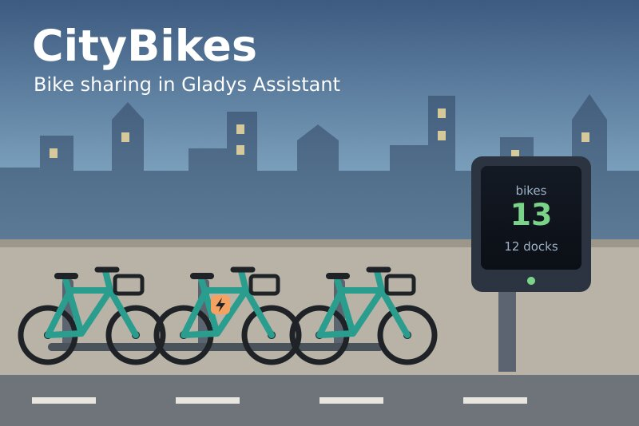
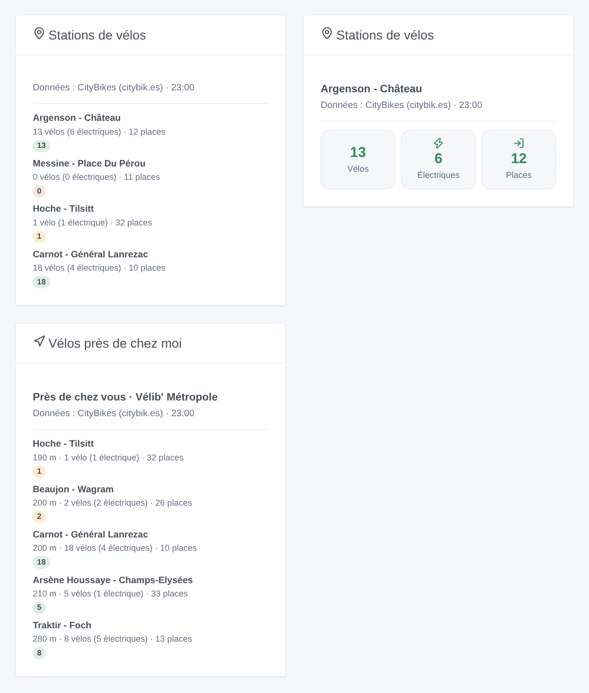
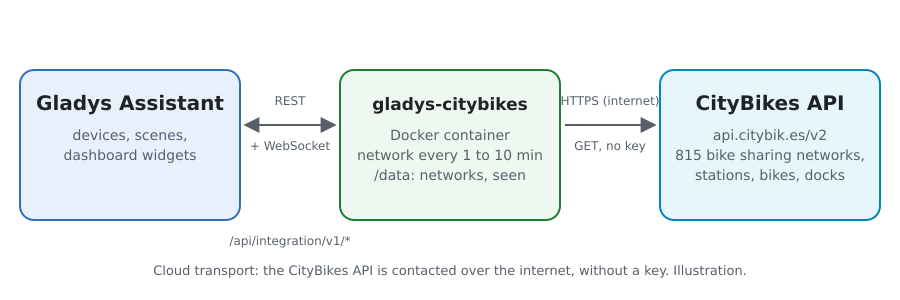
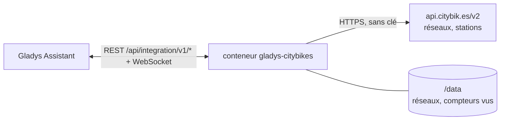
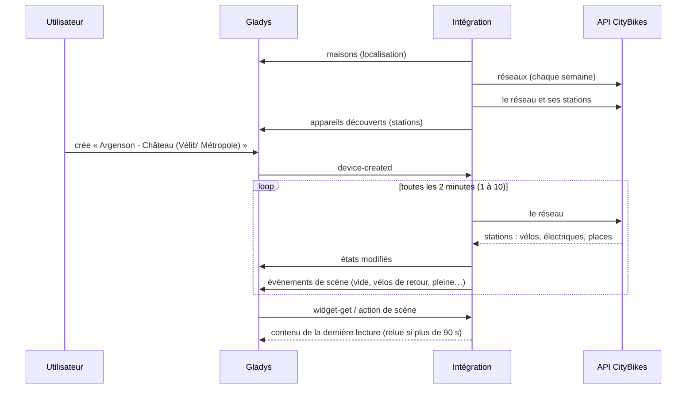

# Gladys CityBikes

[English](README.md) · **Français** · [Deutsch](README.de.md) · [Español](README.es.md)

[](LICENSE)
[](https://github.com/William-De71/gladys-citybikes/releases)
[](https://github.com/William-De71/gladys-citybikes/actions/workflows/release.yml)
[](https://gladysassistant.com)



Intégration externe [Gladys Assistant](https://gladysassistant.com) pour les **stations de vélos en libre-service** de plus de 800 réseaux dans le monde (Vélib', Vélo'v, V3, V'Lille, Bicing, nextbike, Santander Cycles…) : vélos, vélos électriques et places libres de vos stations, avec scènes et widgets de tableau de bord. Elle lit l’API gratuite [CityBikes](https://citybik.es), sans compte ni clé.

Documentation utilisateur : [English](docs/en.md) · [Français](docs/fr.md) · [Deutsch](docs/de.md) · [Español](docs/es.md).

> Intégration communautaire, sans lien avec le projet CityBikes ni avec un opérateur de vélos en libre-service, et non approuvée par eux. Données : CityBikes (citybik.es).

## Fonctionnalités

- **Le réseau** saisi par identifiant CityBikes, nom ou ville, ou celui **le plus proche de la maison** (autorisation de localisation).
- **Un appareil par station suivie** : jusqu’à 20 saisies par identifiant ou nom, plus les 1 à 5 plus proches de la maison. Vélos disponibles, vélos électriques, vélos mécaniques et places libres, chacun quand l’opérateur le donne.
- **6 déclencheurs de scène** : vélos de nouveau disponibles, station vide, vélos électriques de retour, plus de vélo électrique, places de nouveau libres, station pleine.
- **2 actions de scène** : lire une station ; trouver la station la plus proche avec un vélo, un vélo électrique ou une place libre, depuis la maison ou depuis une station suivie.
- **2 widgets de tableau de bord** : les stations suivies, et les stations près de chez vous.
- **Boutons de configuration** : tester la connexion, chercher un réseau, chercher une station, diagnostic.
- Une requête par lecture du réseau (toutes les 1 à 10 minutes), dans les 300 requêtes par heure de l’API ; quatre langues (anglais, français, allemand, espagnol).



## Fonctionnement





Au démarrage, l’intégration lit la liste des réseaux CityBikes (gardée dans `/data`, relue chaque semaine) et les maisons de Gladys, puis choisit le réseau : celui saisi, sinon le plus proche de la maison. Chaque lecture demande tout le réseau en une requête (`/v2/networks/<id>`, 1 516 stations pour Vélib'), retrouve les stations saisies par identifiant ou nom et les plus proches de la maison, publie les états qui ont changé et compare les compteurs avec la lecture précédente pour lancer les déclencheurs de scène.



### Transport

Cloud uniquement (`"transports": ["cloud"]`) : le catalogue affiche le badge cloud, et il n’y a pas de bouton « Préférer la connexion locale ». L’intégration contacte `api.citybik.es`. Les coordonnées de la maison (`"location": true`) ne servent qu’à l’intérieur du conteneur pour calculer les distances : elles ne sont jamais envoyées à CityBikes ni écrites dans les journaux.

## Appareils et fonctionnalités

| Fonctionnalité                | Catégorie / type           | Plage   | Quand                                               |
| ----------------------------- | -------------------------- | ------- | --------------------------------------------------- |
| Vélos disponibles             | `counter-sensor` / integer | 0 – 999 | toujours                                            |
| Vélos électriques disponibles | `counter-sensor` / integer | 0 – 999 | l’opérateur compte les électriques (Vélib', Vélo'v) |
| Vélos mécaniques disponibles  | `counter-sensor` / integer | 0 – 999 | l’opérateur les compte                              |
| Places libres                 | `counter-sensor` / integer | 0 – 999 | l’opérateur les donne (pas les réseaux sans borne)  |

Identifiant externe : `station:<réseau>_<identifiant opérateur>` (`station:velib_22002`). `should_poll` vaut false : l’intégration lit selon son propre minuteur.

## Déclencheurs, actions de scène et widgets

| Type        | Clé                | Usage                                                                           |
| ----------- | ------------------ | ------------------------------------------------------------------------------- |
| Déclencheur | `bikes_available`  | Plus de vélo à une station, puis au moins un.                                   |
| Déclencheur | `station_empty`    | Le dernier vélo pris (ou la station fermée).                                    |
| Déclencheur | `ebikes_available` | Plus de vélo électrique, puis au moins un.                                      |
| Déclencheur | `ebikes_gone`      | Le dernier vélo électrique pris.                                                |
| Déclencheur | `docks_available`  | Une station pleine, puis une place libre.                                       |
| Déclencheur | `station_full`     | Plus de place libre : impossible d’y rendre un vélo.                            |
| Action      | `get_station`      | Compteurs d’une station et une phrase.                                          |
| Action      | `find_station`     | Station la plus proche avec un vélo, un électrique ou une place, et une phrase. |
| Widget      | `stations`         | Les stations suivies : des tuiles pour une, une liste pour plusieurs.           |
| Widget      | `nearby`           | Les 1 à 8 stations les plus proches de la maison.                               |

Les déclencheurs se filtrent sur un appareil station ; leurs variables donnent la station, le réseau et les compteurs (-1 quand inconnus). La première lecture d’une station sert de référence, et les compteurs vus sont gardés dans `/data` : un redémarrage ne relance jamais deux fois le même événement.

Exemples :

- « Station vide » à la station en bas de chez vous, les matins de semaine → envoyer « Plus de vélo en bas » sur votre téléphone.
- « Vélos électriques de retour » → l’annoncer sur l’enceinte de l’entrée.
- À 18 h → « trouver la station la plus proche » avec une place libre depuis la station du bureau → envoyer son résumé.

## Prérequis

- Gladys Assistant **5.3.0** ou plus récent (widgets et déclencheurs de scène des intégrations externes, mots-clés du catalogue de Gladys 5.3). Les instances plus anciennes ne peuvent pas installer l’intégration.
- Pour les stations près de la maison : une position pour la maison dans Gladys et l’autorisation de localisation acceptée à l’installation.

## Installation

- **Depuis le store** de Gladys (Intégrations → Intégrations externes), en un clic, une fois indexée.
- **Depuis l’URL du dépôt** : `https://github.com/William-De71/gladys-citybikes`.
- **Mode développeur** : construisez l’image en local (`docker build -t gladys-citybikes .`) et installez-la depuis Gladys.

## Configuration

| Champ                      | Description                                                                                    |
| -------------------------- | ---------------------------------------------------------------------------------------------- |
| Réseau                     | Identifiant CityBikes (« velib »), nom ou ville. Vide : le réseau le plus proche de la maison. |
| Maison                     | La maison à partir de laquelle sont comptées les distances. Vide : la première localisée.      |
| Stations suivies           | Jusqu’à 20 identifiants ou noms exacts, séparés par des virgules.                              |
| Stations près de la maison | Aucune, 1, 2, 3 (par défaut) ou 5.                                                             |
| Lecture des stations       | 1, 2 (par défaut), 5 ou 10 minutes.                                                            |
| Langue des textes          | Noms des fonctionnalités, résumés et sorties des scènes.                                       |

Boutons : **Tester la connexion**, **Chercher un réseau** (identifiants des réseaux d’une ville, ou les plus proches de la maison), **Chercher une station** (identifiants et vélos en ce moment) et **Diagnostic** (écrit le réseau, les stations, la dernière lecture, les erreurs et le quota restant dans l’onglet Journaux).

## Utilisation

1. Laissez le réseau vide (le plus proche de la maison) ou trouvez son identifiant avec **Chercher un réseau** ; ajoutez des stations si vous le souhaitez, puis enregistrez.
2. Dans l’onglet **Découvrir**, créez les appareils stations.
3. Ajoutez les widgets **Stations de vélos** et **Vélos près de chez moi** à un tableau de bord, et construisez des scènes avec les déclencheurs ci-dessus.

## Développement

```bash
npm install
npm test                       # node --test, ne touche jamais le réseau
npm run lint && npm run format:check
npx github:GladysAssistant/integration-store . --skip-image-check
scripts/build-cover.sh         # cover.jpg depuis docs/assets/cover.svg
docs/illustrations/render.sh   # docs/assets/widgets.<langue>.png
node .github/scripts/release.mjs next
```

En local, le SDK lit `GLADYS_HOST_API_URL`, `GLADYS_INTEGRATION_TOKEN` et `GLADYS_INTEGRATION_SELECTOR` ; `CITYBIKES_API_URL` envoie l’intégration vers une autre racine d’API (un simulateur) ; `DEBUG=gladys-integration-sdk` affiche les journaux du SDK et vérifie chaque contenu de widget. Les tests utilisent de vraies réponses de l’API CityBikes, réduites (`test/fixtures/`). Les règles du projet sont dans [CLAUDE.md](CLAUDE.md).

## Processus de release


Chaque fusion sur `main` lance la CI, puis calcule la version depuis les [Conventional Commits](https://www.conventionalcommits.org/) depuis le dernier tag : `feat` → mineure, `fix` / `perf` → correctif, `!` ou `BREAKING CHANGE` → majeure (une mineure sous 1.0.0) ; `docs`, `chore`, `ci`, `test`, `style`, `refactor`, `build` seuls ne publient rien. La section du changelog est générée, le tag poussé, l’image multi-architecture construite, puis `main` reçoit le commit de release, la GitHub Release est créée et un dernier job vérifie l’image publique, le validateur du store et le topic.

- Le titre de la pull request devient le commit de squash, puis la ligne du changelog : écrivez-le en anglais, pour l’utilisateur (`pr-title.yml` le vérifie). Ne modifiez jamais `CHANGELOG.md` à la main.
- La 1.0.0 est une décision : Actions → Release → Run workflow avec `release-as: 1.0.0`. `dry-run` montre la version et les notes sans publier.
- **Branche protégée** : la release pousse son commit sur `main` avec `GITHUB_TOKEN`. Avec un ruleset sur `main` plus strict que « ni suppression, ni force-push », ajoutez GitHub Actions à sa liste de contournement (ou poussez via une GitHub App), sinon le job de publication échoue avec des instructions.
- Après la première release, rendez le package `ghcr.io` public (Package settings → Change visibility), sinon Gladys ne peut pas le télécharger.

## Dépannage

Voir [docs/fr.md](docs/fr.md#dépannage). Signalez les problèmes avec les versions de Gladys et de l’intégration, le réseau et la station concernés, et les lignes du bouton **Diagnostic**.

## Contribuer

Les issues et pull requests sont les bienvenues. Lancez `npm run format:check && npm run lint && npm test` avant d’ouvrir une pull request, et gardez inchangés tous les identifiants externes et clés stockées (voir [CLAUDE.md](CLAUDE.md)).

## Sécurité

Voir [SECURITY.md](SECURITY.md) : signalez les vulnérabilités en privé. L’intégration n’a besoin d’aucun secret : elle ne lit que des données publiques, et tourne en lecture seule, sous un utilisateur non root, dans son conteneur.

## Captures à venir

Les images ci-dessus sont des illustrations, pas des captures d’écran. Les vraies captures iront dans `docs/assets/screenshots/` (PNG, 1280 × 800) : `configuration.png`, `discovery.png`, `device.png`, `scene.png`.

## Licence

[Licence Apache 2.0](LICENSE) — voir aussi [NOTICE](NOTICE). Les données viennent du projet [CityBikes](https://citybik.es) (API propulsée par [PyBikes](https://github.com/eskerda/pybikes)), dont les conditions demandent à chaque projet qui l’utilise de le dire et d’y renvoyer : les widgets, les docs et ce README le font. Merci à la documentation et au SDK de Gladys, et au projet CityBikes.
