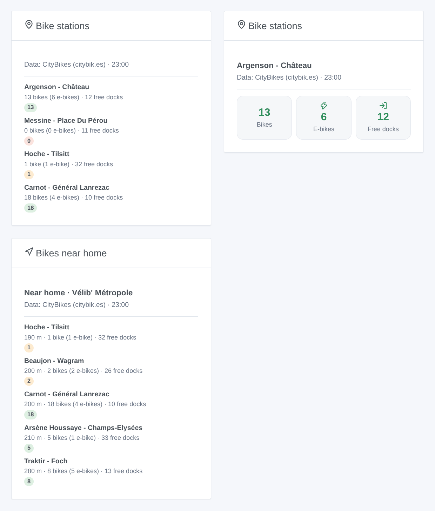
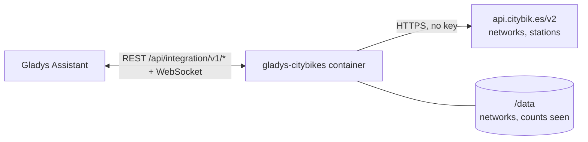
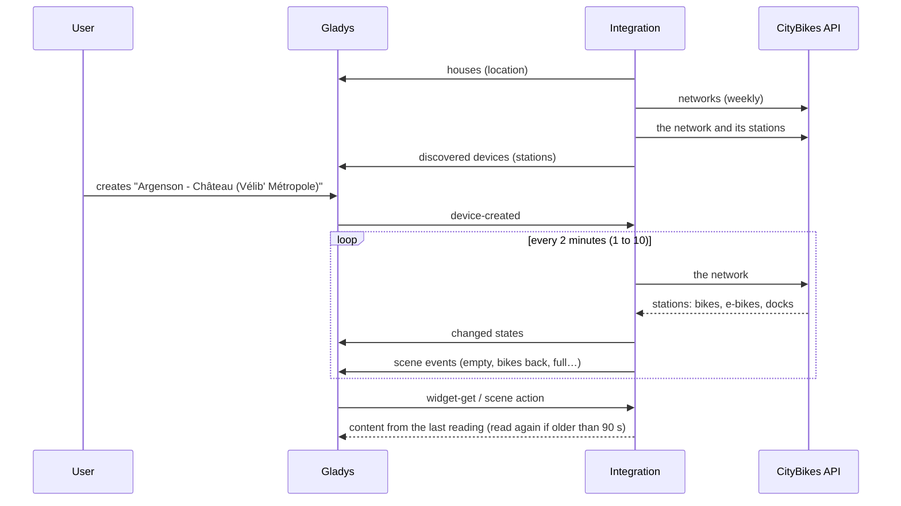

# Gladys CityBikes

**English** · [Français](README.fr.md) · [Deutsch](README.de.md) · [Español](README.es.md)

[](LICENSE)
[](https://github.com/William-De71/gladys-citybikes/releases)
[](https://github.com/William-De71/gladys-citybikes/actions/workflows/release.yml)
[](https://gladysassistant.com)


[Gladys Assistant](https://gladysassistant.com) external integration for the **bike sharing stations** of more than 800 networks in the world (Vélib', Vélo'v, V3, V'Lille, Bicing, nextbike, Santander Cycles…): available bikes, e-bikes and free docks at your stations, with scenes and dashboard widgets. It reads the free [CityBikes](https://citybik.es) API, without an account or a key.

User documentation: [English](docs/en.md) · [Français](docs/fr.md) · [Deutsch](docs/de.md) · [Español](docs/es.md).

> Community integration, not affiliated with nor endorsed by the CityBikes project or any bike sharing operator. Data: CityBikes (citybik.es).

## Features

- **The network** typed by CityBikes id, name or city, or the one **nearest to the house** (location permission).
- **One device per followed station**: up to 20 typed by id or name, plus the 1 to 5 nearest to the house. Available bikes, e-bikes, mechanical bikes and free docks, each when the operator gives it.
- **6 scene triggers**: bikes available again, station empty, e-bikes available again, no e-bike left, free docks again, station full.
- **2 scene actions**: read a station; find the nearest station with a bike, an e-bike or a free dock, from the house or from a followed station.
- **2 dashboard widgets**: the followed stations, and the stations near home.
- **Configuration buttons**: test the connection, find a network, find a station, diagnostic.
- One request per reading of the network (every 1 to 10 minutes), within the 300 requests per hour of the API; four languages (English, French, German, Spanish).



## How it works




At start, the integration reads the list of the CityBikes networks (kept in `/data`, read again weekly) and the houses of Gladys, then picks the network: the one typed, else the one nearest to the house. Each reading asks for the whole network in one request (`/v2/networks/<id>`, 1 516 stations for Vélib'), finds the typed stations by id or name and the nearest to the house, publishes the states that changed and compares the counts with the previous reading to fire the scene triggers.



### Transport

Cloud only (`"transports": ["cloud"]`): the catalog shows the cloud badge, and there is no "prefer the local connection" button. The integration contacts `api.citybik.es`. The coordinates of the house (`"location": true`) are only used inside the container to compute distances: they are never sent to CityBikes nor logged.

## Devices and features

| Feature                    | Category / type            | Range   | When                                             |
| -------------------------- | -------------------------- | ------- | ------------------------------------------------ |
| Available bikes            | `counter-sensor` / integer | 0 – 999 | always                                           |
| Available e-bikes          | `counter-sensor` / integer | 0 – 999 | the operator counts the e-bikes (Vélib', Vélo'v) |
| Available mechanical bikes | `counter-sensor` / integer | 0 – 999 | the operator counts them                         |
| Free docks                 | `counter-sensor` / integer | 0 – 999 | the operator gives them (not free-floating)      |

External id: `station:<network>_<operator id>` (`station:velib_22002`). `should_poll` is false: the integration reads on its own timer.

## Scene triggers, actions and widgets

| Kind    | Key                | Use                                                                    |
| ------- | ------------------ | ---------------------------------------------------------------------- |
| Trigger | `bikes_available`  | No bike at a station, then at least one.                               |
| Trigger | `station_empty`    | The last bike taken (or the station closed).                           |
| Trigger | `ebikes_available` | No e-bike, then at least one.                                          |
| Trigger | `ebikes_gone`      | The last e-bike taken.                                                 |
| Trigger | `docks_available`  | A full station, then a free dock.                                      |
| Trigger | `station_full`     | No free dock left: no bike can be returned.                            |
| Action  | `get_station`      | Counts of a station and a sentence.                                    |
| Action  | `find_station`     | Nearest station with a bike, an e-bike or a free dock, and a sentence. |
| Widget  | `stations`         | The followed stations: tiles for one, a list for several.              |
| Widget  | `nearby`           | The 1 to 8 stations nearest to the house.                              |

The triggers can be filtered on a station device; their variables give the station, the network and the counts (-1 when unknown). The first reading of a station is a baseline, and the counts seen are kept in `/data`: a restart never fires the same event twice.

Examples:

- "Station empty" at the station under your window, on weekday mornings → send "No bike left downstairs" to your phone.
- "E-bikes available again" → announce it on the speaker of the hall.
- At 18:00 → "find the nearest station" with a free dock from the station of the office → send its summary.

## Requirements

- Gladys Assistant **5.3.0** or later (widgets and scene triggers of external integrations, catalog keywords of Gladys 5.3). Older instances cannot install the integration.
- For the stations near the house: a location for the house in Gladys and the location permission accepted at installation.

## Installation

- **From the store** of Gladys (Integrations → External integrations), in one click, once indexed.
- **From the repository URL**: `https://github.com/William-De71/gladys-citybikes`.
- **Developer mode**: build the image locally (`docker build -t gladys-citybikes .`) and install it from Gladys.

## Configuration

| Field                   | Description                                                                    |
| ----------------------- | ------------------------------------------------------------------------------ |
| Network                 | CityBikes id ("velib"), name or city. Empty: the network nearest to the house. |
| House                   | The house the distances are counted from. Empty: the first located house.      |
| Followed stations       | Up to 20 ids or exact names, separated by commas.                              |
| Stations near the house | None, 1, 2, 3 (default) or 5.                                                  |
| Reading of the stations | 1, 2 (default), 5 or 10 minutes.                                               |
| Language of the texts   | Feature names, scene summaries and outputs.                                    |

Buttons: **Test the connection**, **Find a network** (ids of the networks of a city, or the nearest to the house), **Find a station** (ids and bikes now) and **Diagnostic** (writes the network, stations, last reading, errors and quota left to the Logs tab).

## Usage

1. Leave the network empty (nearest to the house) or find its id with **Find a network**; add stations if you wish, then save.
2. In the **Discover** tab, create the station devices.
3. Add the **Bike stations** and **Bikes near home** widgets to a dashboard, and build scenes with the triggers above.

## Development

```bash
npm install
npm test                       # node --test, never touches the network
npm run lint && npm run format:check
npx github:GladysAssistant/integration-store . --skip-image-check
scripts/build-cover.sh         # cover.jpg from docs/assets/cover.svg
docs/illustrations/render.sh   # docs/assets/widgets.<lang>.png
node .github/scripts/release.mjs next
```

Locally, the SDK reads `GLADYS_HOST_API_URL`, `GLADYS_INTEGRATION_TOKEN` and `GLADYS_INTEGRATION_SELECTOR`; `CITYBIKES_API_URL` points the integration to another API root (a mock); `DEBUG=gladys-integration-sdk` shows the SDK logs and checks every widget content. The tests use real answers of the CityBikes API, reduced (`test/fixtures/`). The rules of the project are in [CLAUDE.md](CLAUDE.md).

## Release process


Every merge on `main` runs the CI, then computes the version from the [Conventional Commits](https://www.conventionalcommits.org/) since the last tag: `feat` → minor, `fix` / `perf` → patch, `!` or `BREAKING CHANGE` → major (a minor below 1.0.0); `docs`, `chore`, `ci`, `test`, `style`, `refactor`, `build` alone publish nothing. The changelog section is generated, the tag pushed, the multi-architecture image built, then `main` receives the release commit, the GitHub Release is created and a last job checks the public image, the store validator and the topic.

- The pull request title becomes the squash commit, then the changelog line: write it in English, for the user (`pr-title.yml` checks it). Never edit `CHANGELOG.md` by hand.
- 1.0.0 is a decision: Actions → Release → Run workflow with `release-as: 1.0.0`. `dry-run` shows the version and the notes without publishing.
- **Protected branch**: the release pushes its commit to `main` with `GITHUB_TOKEN`. With a ruleset on `main` stricter than "no deletion, no force-push", add GitHub Actions to its bypass list (or push through a GitHub App), otherwise the publish job fails with instructions.
- After the first release, make the `ghcr.io` package public (Package settings → Change visibility), or Gladys cannot pull it.

## Troubleshooting

See [docs/en.md](docs/en.md#troubleshooting). Report issues with the versions of Gladys and of the integration, the network and station concerned, and the lines of the **Diagnostic** button.

## Contributing

Issues and pull requests are welcome. Run `npm run format:check && npm run lint && npm test` before opening a pull request, and keep every external id and stored key unchanged (see [CLAUDE.md](CLAUDE.md)).

## Security

See [SECURITY.md](SECURITY.md): report vulnerabilities privately. The integration needs no secret: it only reads public data, and runs read-only, as a non-root user, in its container.

## Screenshots to come

The images above are illustrations, not screenshots. Real screenshots will go in `docs/assets/screenshots/` (PNG, 1280 × 800): `configuration.png`, `discovery.png`, `device.png`, `scene.png`.

## License

[Apache License 2.0](LICENSE) — see also [NOTICE](NOTICE). The data come from the [CityBikes](https://citybik.es) project (API powered by [PyBikes](https://github.com/eskerda/pybikes)), whose terms ask every project using it to say so and link to it: the widgets, the docs and this README do. Thanks to the Gladys documentation and SDK, and to the CityBikes project.
